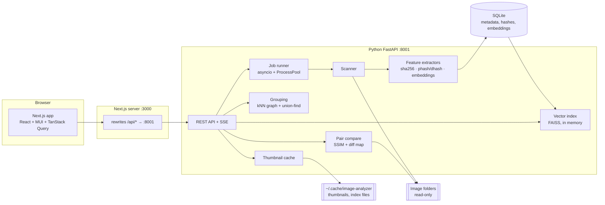

# Image Analyzer: Design

A local application that scans image folders, extracts features from each image, and finds images
that are identical, near-identical or visually similar. The backend is written in Python and serves
a Next.js (React) web UI.

## 1. Goals and non-goals

**Goals**
- Register one or more local folders ("libraries") and scan them recursively.
- Find three kinds of match, reported separately:
  1. **Exact duplicates:** byte-identical files.
  2. **Near-duplicates:** the same image after resizing, recompression, format change, small crops
     or color tweaks.
  3. **Similar images:** the same suImage Analyzer: Design
A local application that scans image folders, extracts features from each image, and finds images that are identical, near-identical or visually similar. The backend is written in Python and serves a Next.js (React) web UI.

1. Goals and non-goals
Goals

Register one or more local folders ("libraries") and scan them recursively.
Find three kinds of match, reported separately:
Exact duplicates: byte-identical files.
Near-duplicates: the same image after resizing, recompression, format change, small crops or color tweaks.
Similar images: the same subject, scene or style, but a different photo.
Browse a library, open an image and see its closest matches, with a similarity threshold you can adjust.
Show groups (clusters) of duplicates across a library.
Compare any two images side by side with a breakdown of their scores.
Search by dropping in an image that isn't in a library.
Rescan incrementally, processing only new or changed files.
Non-goals (v1)

Deleting, moving or renaming files. The app is read-only on your image folders. Duplicate groups can be exported as a list instead.
Multiple users, login or deployment beyond localhost.
Video files.
Cloud storage. Local or mounted paths only.
2. Similarity model
Layer	Technique	Catches	Misses	Cost per image
Exact	SHA-256 of file bytes	Copies, renamed files	Any re-encoding	Trivial (I/O-bound)
Near-duplicate	Perceptual hashes: pHash (DCT) and dHash (gradient), 64 bits each; compared by Hamming distance	Resizing, JPEG recompression, format conversion, mild brightness and contrast changes, watermarks	Large crops, rotation, mirroring, different shots of the same scene	~1 ms (CPU)
Similar	Neural embeddings (default DINOv2 ViT-S/14, 384-d; CLIP ViT-B/32 optional), L2-normalized, compared by cosine similarity	Same object or scene, burst shots, crops, rotations, edits	It's fuzzy: two different beaches can score high	~5–10 ms on the GTX 1650 in batches
Pairwise (on demand)	SSIM plus a per-pixel difference heatmap after aligning sizes	Exactly where two near-duplicates differ	Not suitable for search, because it's O(N²)	~20–50 ms per pair
Preprocessing for every image: decode with Pillow, apply the EXIF orientation (ImageOps.exif_transpose), convert to RGB and flatten transparency onto white. Without the EXIF step, a phone photo and its correctly rotated copy produce different hashes.

Match classification. Each candidate pair gets a verdict computed from its scores: exact | near_duplicate | similar | different. The thresholds are configurable, and the defaults will be tuned with the evaluation set (see PLAN.md, Phase 2):

Verdict	Default rule (starting point)
exact	Same SHA-256
near_duplicate	pHash distance ≤ 8 or (pHash ≤ 14 and cosine ≥ 0.92)
similar	cosine ≥ 0.75
different	Anything else
Model choice. DINOv2 is trained on images alone and is stronger at finding the same thing (instance-level similarity). CLIP is trained on image–text pairs, so it also allows text search ("red car at night") but is slightly weaker at pure visual matching. The extractor is a plug-in interface, so a library can store embeddings from more than one model.

3. Architecture
Python FastAPI :8001

Next.js server :3000

Browser

Next.js app
React + MUI + TanStack Query

rewrites /api/* → :8001

REST API + SSE

Job runner
asyncio + ProcessPool

Scanner

Feature extractors
sha256 · phash/dhash · embeddings

Vector index
FAISS, in memory

Grouping
kNN graph + union-find

Pair compare
SSIM + diff map

Thumbnail cache

SQLite
metadata, hashes, embeddings

Image folders
read-only

~/.cache/image-analyzer
thumbnails, index files


The browser only talks to Next.js. Next.js rewrites forwards /api/* to FastAPI, so the UI and API share an origin: no CORS setup, and the backend stays bound to 127.0.0.1.
Feature extraction is CPU- and GPU-heavy, so it never runs on the request path. A scan is a job. The API returns a job ID immediately and streams progress over Server-Sent Events.
4. Backend
Stack: Python 3.14, uv, FastAPI, Pydantic v2, Pillow (+ pillow-heif for HEIC), imagehash, NumPy, PyTorch + transformers (DINOv2) or open_clip_torch (CLIP), faiss-cpu, scikit-image (SSIM), SQLite via the sqlite3 standard library module, and pytest.

Check that PyTorch and FAISS publish wheels for Python 3.14 before you start. If either lags behind, pin the project to 3.13 rather than building from source.

4.1 Package layout
backend/
  pyproject.toml
  src/image_analyzer/
    __init__.py          # main(): uvicorn entry point
    api/                 # FastAPI routers: libraries, images, jobs, similar, groups, compare, search
    core/
      config.py          # settings: data dir, thresholds, model name, device
      db.py              # SQLite connection, migrations
      models.py          # Pydantic schemas (also the source of the frontend's TS types)
    pipeline/
      scanner.py         # walk folders, detect new/changed/removed files
      decode.py          # safe open, EXIF transpose, RGB, size limits
      hashing.py         # sha256, phash, dhash
      embeddings.py      # Extractor protocol + DINOv2 / CLIP implementations
      thumbnails.py
    search/
      index.py           # FAISS index build/load/query, per library + model
      grouping.py        # kNN graph → union-find clusters
      verdict.py         # scores → exact / near_duplicate / similar / different
      compare.py         # SSIM + diff heatmap
    jobs/
      runner.py          # job queue, progress events, cancellation
  tests/

4.2 Data model (SQLite)
libraries  (id, root_path UNIQUE, name, created_at, last_scan_at)
images     (id, library_id, rel_path, size_bytes, mtime_ns, sha256, width, height, format,
            status,            -- pending | ok | error
            error, indexed_at,
            UNIQUE(library_id, rel_path))
-- Phase 2 (as built): on images, not a separate table. 8 orientations x 8 bytes each:
--   images.phash8 BLOB, images.dhash8 BLOB, images.features_version INTEGER
embeddings (image_id, model, dim, vector BLOB,           -- float32 bytes, L2-normalized
            PRIMARY KEY(image_id, model))
jobs       (id, kind, library_id, status, total, done, failed, message, started_at, finished_at)

Why SQLite: it's a single local file with no server, and it's fast enough for hundreds of thousands of rows. Vectors are kept as BLOBs, which are the durable copy. The FAISS index is a rebuildable cache loaded into memory. (Postgres + pgvector is the alternative. See PLAN.md, open decisions.)
Incremental rescans: a file is reprocessed only when (size_bytes, mtime_ns) changes. Files that disappear are marked removed. A matching sha256 at a new path is treated as a move, so its features are kept.
4.3 API
Method	Path	Purpose
POST	/api/libraries	Register a folder {path, name}. The path must exist and be a directory.
GET	/api/libraries	List libraries with counts and last scan time.
POST	/api/libraries/{id}/scan	Start an incremental scan and return {job_id}. ?full=true forces reprocessing.
GET	/api/jobs/{id}	Job status.
GET	/api/jobs/{id}/events	SSE progress stream: {done, total, failed, current}.
DELETE	/api/jobs/{id}	Cancel a job.
GET	/api/images?library_id=&cursor=&limit=&sort=	Paginated gallery (cursor-based).
GET	/api/images/{id}	Metadata.
GET	/api/images/{id}/thumbnail?size=256	Cached JPEG/WebP thumbnail.
GET	/api/images/{id}/file	The original image, streamed.
GET	/api/images/{id}/similar?method=semantic|perceptual&k=24&min_score=	Ranked matches with scores and verdicts.
GET	/api/groups?library_id=&level=exact|near_duplicate|similar	Duplicate clusters, largest first.
GET	/api/groups/export?format=csv	Export the groups (instead of deleting).
GET	/api/compare?a=&b=	All scores for a pair plus a diff-heatmap URL.
POST	/api/search/image	Upload an image and get matches, without adding it to a library.
GET	/api/search/text?q=	Text search (CLIP only).
4.4 Processing pipeline
Scan: os.scandir recursively, filtered by extension (jpg jpeg png webp gif bmp tif tiff heic), and diffed against the images table.
Decode and hash (CPU): a ProcessPoolExecutor with roughly cores - 2 workers computes SHA-256, pHash, dHash, width and height, and a 256-px thumbnail from one decode per file.
Embed (GPU): decoded 224-px tensors are batched (32–64) through the model on CUDA, falling back to CPU. One GPU worker is enough, because decoding is the bottleneck.
Write: results are batch-inserted every ~200 images, and progress events are emitted.
Index: at the end of a job, the FAISS index for that library and model is rebuilt (IndexFlatIP for up to ~200k images, which is exact and needs no training).
4.5 Grouping
Comparing every pair is O(N²) and doesn't scale. Instead, for each image query its k (~20) nearest neighbours from FAISS (embeddings), plus pHash neighbours from a FAISS binary index (IndexBinaryFlat, Hamming distance). Keep the edges whose verdict meets the requested level, then union-find those edges into clusters. Cache the result per (library, level, thresholds).

4.6 Safety and robustness
Path safety: images are only ever served by ID, never by a client-supplied path. Every resolved path is checked to stay inside its library root (Path.resolve().is_relative_to(root)).
Decompression bombs: keep Pillow's MAX_IMAGE_PIXELS limit, and skip and record files that exceed it. A corrupt file marks that one image error and never fails the whole job.
Read-only: the backend never writes inside library folders. Everything it produces goes to ~/.cache/image-analyzer (or IMAGE_ANALYZER_DATA_DIR).
Network: the backend binds to 127.0.0.1 only.
5. Frontend
Stack: Next.js (App Router, TypeScript), React 19, MUI 9 (matching your existing cljs templates), TanStack Query for server state, react-virtuoso for large virtualized grids, and openapi-typescript to generate API types from FastAPI's /openapi.json.

5.1 Pages
Route	Purpose
/	Libraries dashboard: add a folder, start a scan, live progress bars from SSE.
/libraries/[id]	Virtualized thumbnail gallery with sort and filter (errors, size, format).
/images/[id]	Large preview and metadata, with a strip of matches. Toggle Near-duplicate / Similar and use a threshold slider that re-queries as you drag (debounced).
/duplicates?library=&level=	Cluster list: each group is a row of thumbnails with a size and resolution badge. "Best copy" (largest resolution) is highlighted. Export button.
/compare?a=&b=	Side-by-side and an overlay with a swipe slider, a diff-heatmap toggle, and a score table (SHA match, pHash/dHash distance, cosine, SSIM, verdict).
/search	Drop an image (or type text when CLIP is enabled) and get ranked results.
5.2 Structure
frontend/
  next.config.ts          # rewrites: /api/:path* → http://127.0.0.1:8001/api/:path*
  src/app/                # routes above (Server Components for layout, Client Components for interaction)
  src/components/         # ThumbnailGrid, MatchStrip, ScoreTable, CompareSwipe, DiffOverlay, ScanProgress
  src/lib/api.ts          # typed fetch wrapper over generated types
  src/lib/types.gen.ts    # generated by openapi-typescript; don't edit
  src/hooks/              # useJobEvents (EventSource), useSimilar, useGroups

Thumbnails are plain  tags pointing at /api/images/{id}/thumbnail. The backend already resizes and caches them, so next/image optimization would only process them a second time.
Interactive pages are client components that use TanStack Query, with caching keyed by (imageId, method, minScore).
6. Performance expectations
These are rough figures for this machine (12 cores, GTX 1650 4 GB, files on the Linux filesystem), to be measured in Phase 5:

Stage	Expected throughput
Hashing and thumbnails (CPU pool)	Several hundred images/s for typical 12 MP JPEGs
Embeddings (DINOv2-S, GPU)	Limited by decoding, so roughly the same as hashing
Similarity query (FAISS flat, 100k × 384)	A few milliseconds
Files on /mnt/c	Many times slower because of the WSL–Windows file bridge. Keep large libraries on the Linux side, or expect long first scans.
Memory: 100k images × 384 floats × 4 bytes is about 150 MB for the vectors, which fits comfortably.

7. Risks
Risk	Mitigation
Thresholds that suit one photo collection fail on another (screenshots, scanned documents, art)	Make thresholds configurable, add an evaluation harness with labelled pairs, and offer a UI slider.
PyTorch or CUDA setup friction in WSL	CPU fallback; the model is small. Check torch.cuda.is_available() at startup and show the result in /api/health.
Python 3.14 wheel gaps (torch, faiss)	Check in Phase 0, and pin to 3.13 if needed.
HEIC and unusual formats	pillow-heif is optional, and unsupported files are reported, not fatal.
Large libraries (>500k)	Switch FAISS to IndexHNSWFlat behind the same index.py interface.bject, scene or style, but a different photo.
- Browse a library, open an image and see its closest matches, with a similarity threshold you can
  adjust.
- Show groups (clusters) of duplicates across a library.
- Compare any two images side by side with a breakdown of their scores.
- Search by dropping in an image that isn't in a library.
- Rescan incrementally, processing only new or changed files.

**Non-goals (v1)**
- Deleting, moving or renaming files. The app is **read-only** on your image folders. Duplicate
  groups can be exported as a list instead.
- Multiple users, login or deployment beyond `localhost`.
- Video files.
- Cloud storage. Local or mounted paths only.

## 2. Similarity model

| Layer | Technique | Catches | Misses | Cost per image |
|---|---|---|---|---|
| Exact | SHA-256 of file bytes | Copies, renamed files | Any re-encoding | Trivial (I/O-bound) |
| Near-duplicate | Perceptual hashes: **pHash** (DCT) and **dHash** (gradient), 64 bits each; compared by Hamming distance | Resizing, JPEG recompression, format conversion, mild brightness and contrast changes, watermarks | Large crops, rotation, mirroring, different shots of the same scene | ~1 ms (CPU) |
| Similar | **Neural embeddings** (default DINOv2 ViT-S/14, 384-d; CLIP ViT-B/32 optional), L2-normalized, compared by cosine similarity | Same object or scene, burst shots, crops, rotations, edits | It's fuzzy: two different beaches can score high | ~5–10 ms on the GTX 1650 in batches |
| Pairwise (on demand) | **SSIM** plus a per-pixel difference heatmap after aligning sizes | Exactly *where* two near-duplicates differ | Not suitable for search, because it's O(N²) | ~20–50 ms per pair |

**Preprocessing for every image:** decode with Pillow, apply the EXIF orientation
(`ImageOps.exif_transpose`), convert to RGB and flatten transparency onto white. Without the EXIF
step, a phone photo and its correctly rotated copy produce different hashes.

**Match classification.** Each candidate pair gets a verdict computed from its scores:
`exact | near_duplicate | similar | different`. The thresholds are configurable, and the defaults
will be tuned with the evaluation set (see PLAN.md, Phase 2):

| Verdict | Default rule (starting point) |
|---|---|
| `exact` | Same SHA-256 |
| `near_duplicate` | pHash distance ≤ 8 **or** (pHash ≤ 14 **and** cosine ≥ 0.92) |
| `similar` | cosine ≥ 0.75 |
| `different` | Anything else |

**Model choice.** DINOv2 is trained on images alone and is stronger at finding *the same thing*
(instance-level similarity). CLIP is trained on image–text pairs, so it also allows **text search**
("red car at night") but is slightly weaker at pure visual matching. The extractor is a plug-in
interface, so a library can store embeddings from more than one model.

## 3. Architecture



- The browser only talks to Next.js. Next.js `rewrites` forwards `/api/*` to FastAPI, so the UI and
  API share an origin: no CORS setup, and the backend stays bound to `127.0.0.1`.
- Feature extraction is CPU- and GPU-heavy, so it never runs on the request path. A scan is a
  **job**. The API returns a job ID immediately and streams progress over Server-Sent Events.

## 4. Backend

**Stack:** Python 3.14, `uv`, FastAPI, Pydantic v2, Pillow (+ `pillow-heif` for HEIC), `imagehash`,
NumPy, PyTorch + `transformers` (DINOv2) or `open_clip_torch` (CLIP), `faiss-cpu`, `scikit-image`
(SSIM), SQLite via the `sqlite3` standard library module, and `pytest`.

> Check that PyTorch and FAISS publish wheels for Python 3.14 before you start. If either lags
> behind, pin the project to 3.13 rather than building from source.

### 4.1 Package layout

```
backend/
  pyproject.toml
  src/image_analyzer/
    __init__.py          # main(): uvicorn entry point
    api/                 # FastAPI routers: libraries, images, jobs, similar, groups, compare, search
    core/
      config.py          # settings: data dir, thresholds, model name, device
      db.py              # SQLite connection, migrations
      models.py          # Pydantic schemas (also the source of the frontend's TS types)
    pipeline/
      scanner.py         # walk folders, detect new/changed/removed files
      decode.py          # safe open, EXIF transpose, RGB, size limits
      hashing.py         # sha256, phash, dhash
      embeddings.py      # Extractor protocol + DINOv2 / CLIP implementations
      thumbnails.py
    search/
      index.py           # FAISS index build/load/query, per library + model
      grouping.py        # kNN graph → union-find clusters
      verdict.py         # scores → exact / near_duplicate / similar / different
      compare.py         # SSIM + diff heatmap
    jobs/
      runner.py          # job queue, progress events, cancellation
  tests/
```

### 4.2 Data model (SQLite)

```sql
libraries  (id, root_path UNIQUE, name, created_at, last_scan_at)
images     (id, library_id, rel_path, size_bytes, mtime_ns, sha256, width, height, format,
            status,            -- pending | ok | error
            error, indexed_at,
            UNIQUE(library_id, rel_path))
-- Phase 2 (as built): on images, not a separate table. 8 orientations x 8 bytes each:
--   images.phash8 BLOB, images.dhash8 BLOB, images.features_version INTEGER
embeddings (image_id, model, dim, vector BLOB,           -- float32 bytes, L2-normalized
            PRIMARY KEY(image_id, model))
jobs       (id, kind, library_id, status, total, done, failed, message, started_at, finished_at)
```

- **Why SQLite:** it's a single local file with no server, and it's fast enough for hundreds of
  thousands of rows. Vectors are kept as BLOBs, which are the durable copy. The FAISS index is a
  rebuildable cache loaded into memory. (Postgres + pgvector is the alternative. See PLAN.md, open
  decisions.)
- **Incremental rescans:** a file is reprocessed only when `(size_bytes, mtime_ns)` changes. Files
  that disappear are marked removed. A matching `sha256` at a new path is treated as a move, so its
  features are kept.

### 4.3 API

| Method | Path | Purpose |
|---|---|---|
| `POST` | `/api/libraries` | Register a folder `{path, name}`. The path must exist and be a directory. |
| `GET` | `/api/libraries` | List libraries with counts and last scan time. |
| `POST` | `/api/libraries/{id}/scan` | Start an incremental scan and return `{job_id}`. `?full=true` forces reprocessing. |
| `GET` | `/api/jobs/{id}` | Job status. |
| `GET` | `/api/jobs/{id}/events` | SSE progress stream: `{done, total, failed, current}`. |
| `DELETE` | `/api/jobs/{id}` | Cancel a job. |
| `GET` | `/api/images?library_id=&cursor=&limit=&sort=` | Paginated gallery (cursor-based). |
| `GET` | `/api/images/{id}` | Metadata. |
| `GET` | `/api/images/{id}/thumbnail?size=256` | Cached JPEG/WebP thumbnail. |
| `GET` | `/api/images/{id}/file` | The original image, streamed. |
| `GET` | `/api/images/{id}/similar?method=semantic\|perceptual&k=24&min_score=` | Ranked matches with scores and verdicts. |
| `GET` | `/api/groups?library_id=&level=exact\|near_duplicate\|similar` | Duplicate clusters, largest first. |
| `GET` | `/api/groups/export?format=csv` | Export the groups (instead of deleting). |
| `GET` | `/api/compare?a=&b=` | All scores for a pair plus a diff-heatmap URL. |
| `POST` | `/api/search/image` | Upload an image and get matches, without adding it to a library. |
| `GET` | `/api/search/text?q=` | Text search (CLIP only). |

### 4.4 Processing pipeline

1. **Scan:** `os.scandir` recursively, filtered by extension (`jpg jpeg png webp gif bmp tif tiff
   heic`), and diffed against the `images` table.
2. **Decode and hash (CPU):** a `ProcessPoolExecutor` with roughly `cores - 2` workers computes
   SHA-256, pHash, dHash, width and height, and a 256-px thumbnail from **one** decode per file.
3. **Embed (GPU):** decoded 224-px tensors are batched (32–64) through the model on CUDA, falling
   back to CPU. One GPU worker is enough, because decoding is the bottleneck.
4. **Write:** results are batch-inserted every ~200 images, and progress events are emitted.
5. **Index:** at the end of a job, the FAISS index for that library and model is rebuilt
   (`IndexFlatIP` for up to ~200k images, which is exact and needs no training).

### 4.5 Grouping

Comparing every pair is O(N²) and doesn't scale. Instead, for each image query its k (~20) nearest
neighbours from FAISS (embeddings), plus pHash neighbours from a FAISS binary index
(`IndexBinaryFlat`, Hamming distance). Keep the edges whose verdict meets the requested level, then
**union-find** those edges into clusters. Cache the result per `(library, level, thresholds)`.

### 4.6 Safety and robustness

- **Path safety:** images are only ever served by **ID**, never by a client-supplied path. Every
  resolved path is checked to stay inside its library root (`Path.resolve().is_relative_to(root)`).
- **Decompression bombs:** keep Pillow's `MAX_IMAGE_PIXELS` limit, and skip and record files that
  exceed it. A corrupt file marks that one image `error` and never fails the whole job.
- **Read-only:** the backend never writes inside library folders. Everything it produces goes to
  `~/.cache/image-analyzer` (or `IMAGE_ANALYZER_DATA_DIR`).
- **Network:** the backend binds to `127.0.0.1` only.

## 5. Frontend

**Stack:** Next.js (App Router, TypeScript), React 19, MUI 9 (matching your existing cljs
templates), TanStack Query for server state, `react-virtuoso` for large virtualized grids, and
`openapi-typescript` to generate API types from FastAPI's `/openapi.json`.

### 5.1 Pages

| Route | Purpose |
|---|---|
| `/` | Libraries dashboard: add a folder, start a scan, live progress bars from SSE. |
| `/libraries/[id]` | Virtualized thumbnail gallery with sort and filter (errors, size, format). |
| `/images/[id]` | Large preview and metadata, with a strip of matches. Toggle **Near-duplicate / Similar** and use a **threshold slider** that re-queries as you drag (debounced). |
| `/duplicates?library=&level=` | Cluster list: each group is a row of thumbnails with a size and resolution badge. "Best copy" (largest resolution) is highlighted. Export button. |
| `/compare?a=&b=` | Side-by-side and an overlay with a swipe slider, a diff-heatmap toggle, and a score table (SHA match, pHash/dHash distance, cosine, SSIM, verdict). |
| `/search` | Drop an image (or type text when CLIP is enabled) and get ranked results. |

### 5.2 Structure

```
frontend/
  next.config.ts          # rewrites: /api/:path* → http://127.0.0.1:8001/api/:path*
  src/app/                # routes above (Server Components for layout, Client Components for interaction)
  src/components/         # ThumbnailGrid, MatchStrip, ScoreTable, CompareSwipe, DiffOverlay, ScanProgress
  src/lib/api.ts          # typed fetch wrapper over generated types
  src/lib/types.gen.ts    # generated by openapi-typescript; don't edit
  src/hooks/              # useJobEvents (EventSource), useSimilar, useGroups
```

- Thumbnails are plain `` tags pointing at `/api/images/{id}/thumbnail`. The backend already
  resizes and caches them, so `next/image` optimization would only process them a second time.
- Interactive pages are client components that use TanStack Query, with caching keyed by
  `(imageId, method, minScore)`.

## 6. Performance expectations

Measured in Phase 5 with `image_analyzer.devtools.bench` on this machine (12 threads, GTX 1650
4 GB, WSL2). The set: 10,000 JPEGs (4.1 GB) generated from `~/Pictures/sample`, **3 MP each**
(2049×1537). It's a first scan with a fresh data directory (thumbnails included) and warm OS
page cache. Runs vary by about ±15% on this laptop.

| 10,000 images, Linux filesystem | images/s | Bottleneck |
|---|---|---|
| Phase 4 pipeline, hashes only | 84 | CPU (full-resolution decode) |
| Phase 4 pipeline, + DINOv2 (CPU and GPU taking turns) | 51 (2k set) | CPU + GPU *added together* |
| + overlapped embed/write thread | 68 | CPU |
| + reduced-size JPEG decode (`draft`) | **199** hashes only / **90** with DINOv2 | **GPU** (~93 images/s ceiling) |

| 2,000 images, final pipeline | Linux | `/mnt/c` before | `/mnt/c` after threaded stat |
|---|---|---|---|
| Listing (walk + stat) | 0.0 s | 13.5 s | 0.5 s |
| Hashes only | 213 images/s | 72 | 134 |
| With DINOv2 | 85 images/s | 54 | 81 |

What was tuned, and why:
- **Workers = cores − 4** (8 here). With embeddings, 8 workers beat 10–12, because extra decoders
  starve the thread feeding the GPU. Without embeddings, more workers help a little.
- **Embed batch 32.** 64 gave no gain; the GPU is already saturated.
- **fp32, not fp16:** 4.5× faster on this GPU, which has no tensor cores. **Normalising on the
  GPU** gave +7%. `torch.compile` fails under Python 3.14 (Triton can't find `Python.h`); not pursued.
- **Write batch 200:** database writes total about 1 s per 10k images, which is negligible.

For other photos: 12 MP phone photos decode at ¼ scale through `draft`, so the CPU stages slow
down much less than the 4× pixel count suggests. The GPU stage doesn't depend on photo size
(always 224×224), so expect roughly 90 images/s with embeddings: about 2 minutes per 10,000 images.

| Query | Latency |
|---|---|
| `/similar` (pHash, 517-image library) | a few ms |
| `/api/compare` (decode two 3 MP images, SSIM at 1024 px) | ~300 ms |
| `/api/search/image` (3 MP upload, hash + embed + score) | ~200 ms |

Memory: 100k images × 384 floats × 4 bytes is about 150 MB for the vectors, which fits comfortably.

## 7. Risks

| Risk | Mitigation |
|---|---|
| Thresholds that suit one photo collection fail on another (screenshots, scanned documents, art) | Make thresholds configurable, add an evaluation harness with labelled pairs, and offer a UI slider. |
| PyTorch or CUDA setup friction in WSL | CPU fallback; the model is small. Check `torch.cuda.is_available()` at startup and show the result in `/api/health`. |
| Python 3.14 wheel gaps (torch, faiss) | Check in Phase 0, and pin to 3.13 if needed. |
| HEIC and unusual formats | `pillow-heif` is optional, and unsupported files are reported, not fatal. |
| Large libraries (>500k) | Switch FAISS to `IndexHNSWFlat` behind the same `index.py` interface. |
